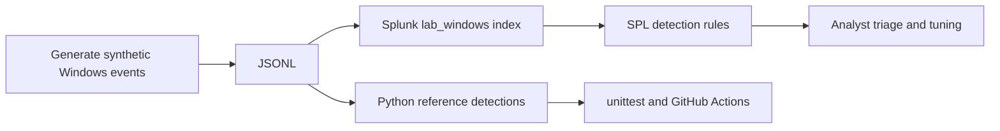

# Splunk SIEM Detection Engineering Lab

  

A GitHub-ready **defensive cybersecurity portfolio lab** using fictional Windows event data, SPL detection searches, MITRE ATT&CK technique mappings, offline reference validation, and CI tests. Created to demonstrate detection design, validation, false-positive consideration, and analyst documentation.

> **Validation status:** Offline Python reference detection checks and tests can run on Windows without Splunk. SPL searches are included but require validation in your own Splunk environment; no claim is made of production deployment.

## Highlights

| ID | Detection | Windows Event | MITRE ATT&CK |
| --- | --- | --- | --- |
| DET-001 | Five failed logons within 10-minute bucket by user/source | 4625 | T1110 Brute Force |
| DET-002 | PowerShell encoded command-line indicator | 4688 | T1059.001 PowerShell |
| DET-003 | New lab-designated Windows service | 7045 | T1543.003 Windows Service |
| DET-004 | Windows account creation | 4720 | T1136.001 Local Account (context-dependent) |

These are intentionally small lab rules, not claims of enterprise-ready correlation searches. DET-004 requires additional asset context before precise ATT&CK subtechnique assignment in real environments.

## Architecture



## Repository contents

```text
splunk-detection-engineering/
  .github/workflows/tests.yml
  dashboards/README.md
  detections/detections.spl
  detections/rules.json
  docs/architecture.md
  docs/test-plan.md
  sample_data/windows_events.jsonl
  scripts/generate_data.py
  scripts/lab.py
  tests/test_lab.py
  LICENSE
  .gitignore
  README.md
```

## Windows quick start (PowerShell)

**Prerequisites:** Windows 10/11, Python 3.10+ installed from python.org (`python --version`), optional Splunk Enterprise/Free trial in a *personal authorized lab*. No Python third-party packages required.

1. Download and extract the project ZIP. Open PowerShell in the extracted folder.
2. Generate deterministic synthetic Windows-style events:

```powershell
python .\scripts\generate_data.py
```

3. Execute all tests:

```powershell
python -m unittest discover -s tests -v
```

4. Produce a local detection report:

```powershell
python .\scripts\lab.py --output .\output\findings.csv
Import-Csv .\output\findings.csv | Format-Table
```

Expected: **20 synthetic events and 4 findings**, one for each detection. The offline engine is a Python reference model, not a Splunk SPL interpreter.

## Optional: Import into Splunk (personal test instance only)

1. Install or open your authorized Splunk Enterprise test instance and sign in.
2. In **Settings → Indexes**, create index `lab_windows` (you must have permissions to manage indexes).
3. Use **Settings → Add Data → Upload**, choose `sample_data/windows_events.jsonl`. Set index `lab_windows`; use JSON timestamp extraction with `_time` field, or map ISO timestamp to Splunk event time. Choose source/sourcetype settings that result in extracted fields (`EventCode`, `user`, `src_ip`, etc.). Some Splunk versions may require an explicit JSON extraction configuration (`INDEXED_EXTRACTIONS=json` or `KV_MODE=json`); **do not enable both** on the same data.
4. Confirm parsed records:

```spl
index=lab_windows | stats count by EventCode
```

5. Open `detections/detections.spl`; run **one query at a time**. Cross-check expected findings and adapt field extraction if needed.
6. Create visualization panels using `dashboards/README.md`.

**Note:** JSONL upload, automatic timestamps, field extraction, and available permissions differ by Splunk version. Ensure `_time` and fields appear as expected before interpreting detection results. The sample uses reserved RFC 5737 documentation addresses (`192.0.2.0/24`) and fictional `LAB-*` hosts.

## Test and engineering approach

- `tests/test_lab.py` checks all four expected reference detections, negative controls, event schema, MITRE IDs, and fictional IP/hostname safety.
- `docs/test-plan.md` describes simulator verification and evidence collection.
- False positives: legitimate admin PowerShell, planned accounts/services, mistyped passwords; incorporate allowlists, asset criticality, behavioral context, and change records before enabling production alerting.
- GitHub Actions executes generation, tests, and reference detection report automatically.

## Ethical use

Only synthetic data is included. Do not collect/export actual Navy, employer, or other sensitive security logs for public publication. Run detections in infrastructure you own or are authorized to test. This project does not perform attacks, remediation, or autonomous blocking.

## Suggested resume entry (after reviewing and independently validating)

**Splunk SIEM Detection Engineering Lab | SPL, Windows Event Logs, Python, MITRE ATT&CK**  
Designed four Splunk-oriented detection searches using synthetic Windows security/system events; mapped detections to MITRE ATT&CK, documented expected false positives, and built a Python reference-validation harness with automated tests.

## Next improvements

- Integrate Sysmon Event ID 1 process telemetry and Windows Event Forwarding in your private lab.
- Map to Splunk Common Information Model (CIM) and validate Splunk Enterprise Security risk-based alerting in an appropriately licensed instance.
- Tune thresholds using baseline behavior and record precision/recall against labeled synthetic test cases.
- Publish **real, sanitized screenshots from your own lab** showing queries and dashboards after completing Splunk-specific verification.

## License

MIT License.
