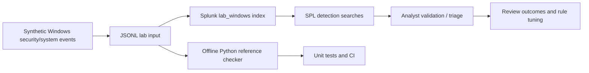

# Architecture

## Data contract
- `_time`: ISO 8601 UTC event timestamp
- `host`: synthetic lab hostname
- `source`, `sourcetype`: Windows log identifiers
- `EventCode`: Windows event ID
- `user`, `src_ip`, `CommandLine`, `ServiceName`, `TargetUserName`: scenario fields

## Detection design notes
These rules are **educational prototypes**. They depend on this lab's field extraction assumptions and must be adapted to real Windows TA / CIM normalization before production use. Windows 7045 is recorded in the System log; the synthetic record reflects that. Account creation 4720 mapping depends on local vs domain collection. No production alerting, response automation, or blocking is configured.

## Scope
Do not upload classified, sensitive, employer, or production log data to a public GitHub repository. Use only generated synthetic events and an authorized personal Splunk lab.
